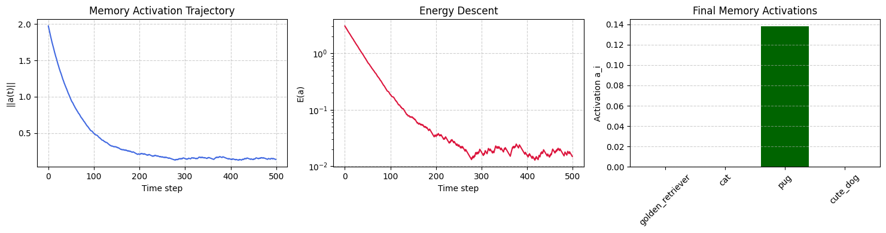
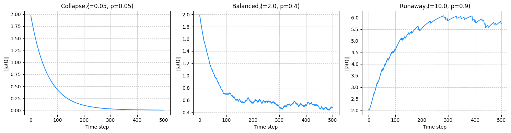
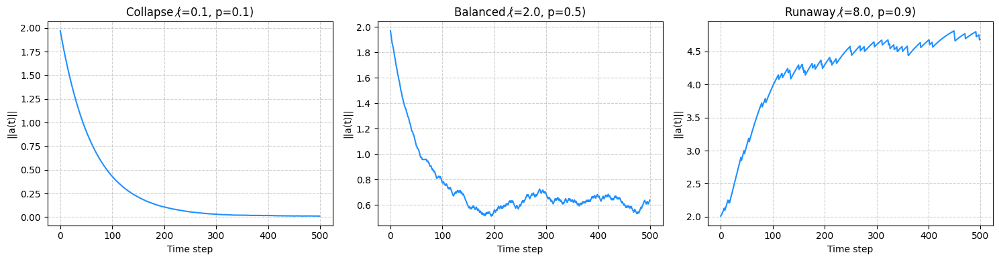
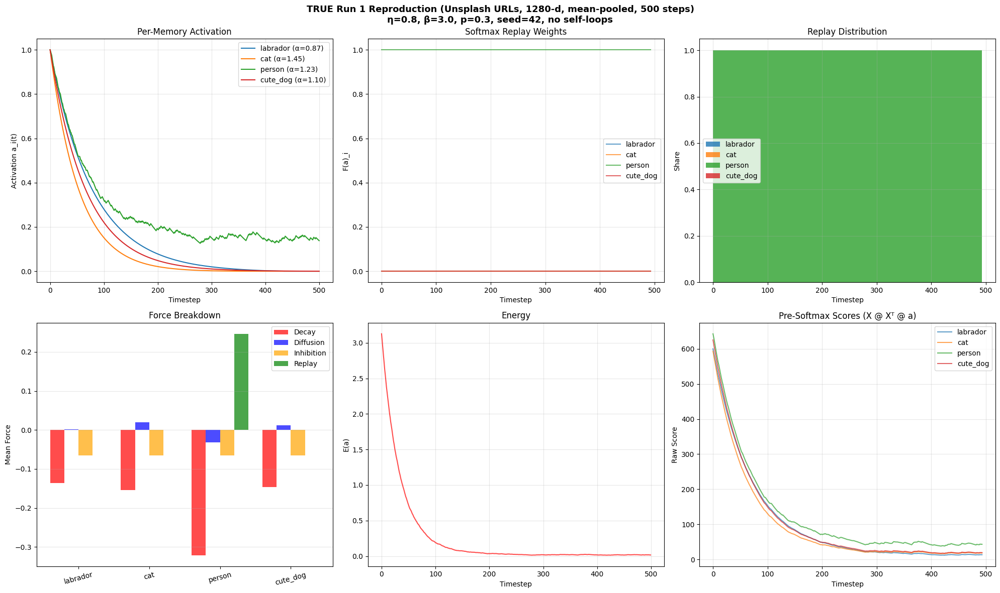
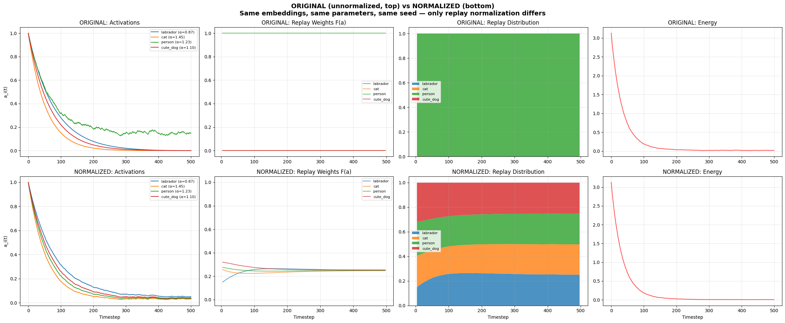
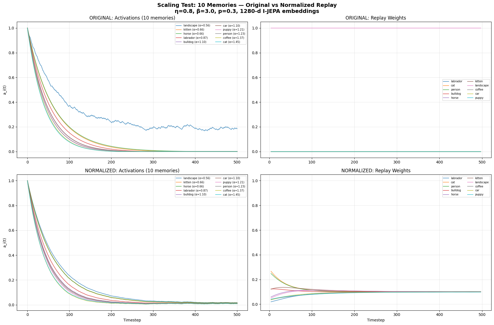
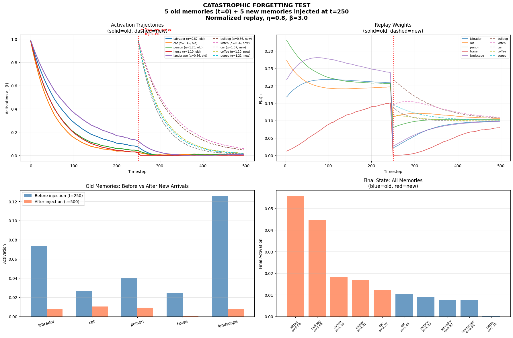

# Dynamical Memory with JEPA Embeddings

Implementation of the dynamical memory framework from
"The Dynamics of Memory: Replay, Diffusion, and Attractor Formation"
(Ghosh, Jaiswal, Gupta — MetaCognition Labs) using real I-JEPA
embeddings from Hugging Face instead of synthetic Gaussians.

The same results are also written up as a website in [`web/`](web/); see [Website](#website). Every Colab notebook behind them is in [`notebooks/`](notebooks/), with its outputs as it ran; see [Colab notebooks](#colab-notebooks).

## What This Implements

The core memory evolution equation:

$$
\frac{da}{dt} = -Aa \;-\; \gamma L a \;-\; \delta\,(\mathbf{1}^\top a)\,\mathbf{1} \;+\; \eta\,S(t)\,F(a)
$$

where $a \in \mathbb{R}^N$ holds one activation per stored memory and every memory starts at $a_i(0) = 1$.

| Term | What it does | Code |
|---|---|---|
| $-Aa$ | **Decay.** $A = \mathrm{diag}(\alpha_i)$, one rate per memory, drawn from $U(0.5,\ 1.5)$. | `decay` |
| $-\gamma L a$ | **Diffusion** over the semantic graph. $L = D - W$ with $W_{ij} = \max(0, \cos(x_i, x_j))$ and $W_{ii} = 0$. | `_build_laplacian` |
| $-\delta(\mathbf{1}^\top a)\mathbf{1}$ | **Global inhibition.** Total activation suppresses every memory equally. | `inhibition` |
| $\eta\,S(t)\,F(a)$ | **Replay.** $S(t) \sim \mathrm{Bernoulli}(p)$ at every step. $F(a) = \mathrm{softmax}(\beta X X^\top a)$, with $X$ the $N \times d$ matrix of raw embeddings. | `_replay_operator` |

- **Integration:** forward Euler, $a \leftarrow \max(0,\ a + h\,\dot a)$, with $h = 0.01$. So 500 steps cover $t \in [0, 5]$.
- **Energy:** $E(a) = \tfrac12 a^\top A a + \tfrac{\gamma}{2} a^\top L a + \tfrac{\delta}{2}(\mathbf{1}^\top a)^2$.
  - The decay, diffusion and inhibition terms of $\dot a$ are exactly $-\nabla E$. Without replay, the system is a gradient flow on $E$.
  - Replay is an external drive and is not part of $E$.
- **Retrieval:** the score of memory $i$ is $\cos(q, x_i) \cdot a_i$, i.e. similarity weighted by current activation.
- **Embeddings:** each image goes through [`facebook/ijepa_vith14_1k`](https://huggingface.co/facebook/ijepa_vith14_1k) (I-JEPA, ViT-H/14). The last hidden state is mean-pooled over patches to a 1280-d vector.

## Setup

Four Unsplash images, each encoded once and stored as a memory. All runs share these settings: $\gamma = 0.2$, $\delta = 0.1$, $\beta = 3.0$, $h = 0.01$, 500 steps, seed 42.

| # | Memory | Decay rate $\alpha$ |
|---|---|---|
| 0 | beagle | 0.87 |
| 1 | cat | 1.45 |
| 2 | person | 1.23 |
| 3 | French bulldog | 1.10 |

> **Labels in the recorded output.** The labels were renamed after the run to match the photos. The printed output and the Colab figures in [`results/`](results/) show the labels used when the notebook ran: `golden_retriever` (beagle), `cat`, `pug` (person) and `cute_dog` (French bulldog). Labels are only used for printing, so no number depends on them.

## Results

Sections 1 to 3 come from the notebook run in [`notebooks/metacognition.ipynb`](notebooks/metacognition.ipynb). Sections 4 to 7 come from the later Colab runs in [`notebooks/colab/`](notebooks/colab/). For sections 1 to 3:

- The printed output is in [`results/notebook_output.txt`](results/notebook_output.txt), copied verbatim.
- Every value is collected in [`results/metrics.json`](results/metrics.json).

### 1. Single run (η = 0.8, p = 0.3)



| Memory | Decay $\alpha$ | Final activation |
|---|---|---|
| beagle | 0.87 | 0 |
| cat | 1.45 | 0 |
| person | 1.23 | **0.1379** |
| French bulldog | 1.10 | 0 |

Final energy is **0.0150**.

- **One memory survives.** Three of the four activations reach exactly 0. The survivor is not the memory with the slowest decay: that was the beagle ($\alpha = 0.87$). Replay picked the winner, not decay.
- **Activation norm.** ‖a‖ falls from 2.0 and settles into a noisy plateau around 0.15 from step ~280 onward.
- **Energy.** $E$ starts at about 3.13 and falls roughly 200× to 0.015. From step ~280 it fluctuates around 0.015–0.02, where replay puts in about as much as decay removes.

### 2. Retrieval

The query is the beagle image, the same image as memory 0.

| Rank | Memory | Score |
|---|---|---|
| 1 | person | 0.0414 |
| 2 | French bulldog | 0.0000 |
| 3 | beagle | 0.0000 |

**The exact-match memory ranks last.**

- The query is identical to the beagle memory (cosine similarity 1), but the beagle's activation decayed to 0.
- The score is cosine × activation, so once activations collapse, only the surviving memory can score above zero.
- Ranks 2 and 3 are tied at 0, so their order is arbitrary.
- The top score implies a cosine similarity between the beagle and person embeddings of about $0.0414 / 0.1379 \approx 0.30$.

### 3. Three dynamical regimes

The same four memories were run under three settings of replay strength $\eta$ and replay probability $p$. The notebook ran two sweeps of this.

#### Sweep B (final version, notebook cell 5)



| Regime | η | p | η·p | Final ‖a‖ | Final E |
|---|---|---|---|---|---|
| Collapse | 0.05 | 0.05 | 0.0025 | 0.0048 | 0.000014 |
| Balanced | 2.0 | 0.4 | 0.8 | 0.5003 | 0.197150 |
| Runaway | 10.0 | 0.9 | 9.0 | 5.7369 | 25.923445 |

- **Collapse.** Replay is too weak to matter. Activation decays smoothly to about 0, as it would with decay alone.
- **Balanced.** ‖a‖ drops over the first ~100 steps, then hovers between about 0.45 and 0.65. Replay and decay offset each other.
- **Runaway.** ‖a‖ climbs from 2.0 to about 5.5–6.1 and stays there. Final energy is about 8× the starting energy. Replay dominates.
  - "Runaway" here means *replay-dominated*, not divergent. $F(a)$ sums to 1, so replay adds at most η per unit time in total, while decay and inhibition grow with $a$. That caps ‖a‖, which is why the curve levels off instead of blowing up.

> The final numbers in the table do **not** come from the plotted runs. Cell 5 plotted the three regimes, then ran each one again with fresh random draws to print the final state. That is why the plotted Balanced curve ends near 0.47 while the table says 0.5003. [`run_experiments.py`](run_experiments.py) takes the figure and the numbers from the same run.

#### Sweep A (first version, notebook cell 3)



| Regime | η | p | η·p | Final ‖a‖ (read off the figure) |
|---|---|---|---|---|
| Collapse | 0.1 | 0.1 | 0.01 | ≈ 0.01 |
| Balanced | 2.0 | 0.5 | 1.0 | ≈ 0.6 (fluctuating 0.5–0.7) |
| Runaway | 8.0 | 0.9 | 7.2 | ≈ 4.7 |

This sweep printed no numbers. Both sweeps show the same three regimes. In both, the level where ‖a‖ settles rises with the replay drive η·p.

### 4. Replay tracking (second Colab run)

A second Colab run repeated the single run with the same images, seed and settings. At every step it logged the softmax replay weights $F(a)$, the pre-softmax scores and each force. It is the cell headed `TRUE RUN 1 REPRODUCTION WITH F(a) TRACKING` in [`notebooks/colab/unnormalised/metacognition_4_memories.ipynb`](notebooks/colab/unnormalised/metacognition_4_memories.ipynb). The earlier cells in that notebook repeat the original notebook's runs, and two exploratory cells just before it use other settings; their output isn't used here.

- **Printed output:** [`results/replay_tracking_output.txt`](results/replay_tracking_output.txt), copied word for word.
- **Numbers:** [`results/replay_tracking.json`](results/replay_tracking.json).
- **Labels:** that run's output and figure use `labrador` for the beagle and `cute_dog` for the French bulldog.



- **It reproduces the first run.** The person ends at 0.137944; the notebook printed 0.13794458.
- **Replay went to one memory.**
  - Replay fired at 154 of the 500 steps.
  - Printed to 4 decimals, the person's replay weight is 1.0000, averaged over the first 10% of events and again over the last 10%. The other three get 0.0000.
  - The figure shows the same split at every replay event.
- **The person's pre-softmax score is the highest at every replay event** (bottom-right panel). Near the start it is about 640, against about 625 for the next, read off the panel. Multiplied by β = 3, a gap that size leaves the others a vanishing share.

Measured cosine similarity between the 1,280-number embeddings:

| | beagle | cat | person | French bulldog |
|---|---|---|---|---|
| beagle | 1.0000 | 0.3188 | 0.3005 | 0.3701 |
| cat | 0.3188 | 1.0000 | 0.4488 | 0.4276 |
| person | 0.3005 | 0.4488 | 1.0000 | 0.4673 |
| French bulldog | 0.3701 | 0.4276 | 0.4673 | 1.0000 |

- Every pair is between 0.30 and 0.47, so no edge of the graph is zero.
- The French bulldog's closest match is the person (0.47), not the beagle (0.37).
- Beagle–person is 0.3005, which matches the 0.30 implied by the retrieval score in §2.

Mean force on each memory over the 500 steps:

| Memory | Decay | Diffusion | Inhibition | Replay | Net |
|---|---|---|---|---|---|
| beagle | −0.13657 | +0.00137 | −0.06559 | 0 | −0.20079 |
| cat | −0.15419 | +0.01930 | −0.06559 | 0 | −0.20047 |
| person | −0.32114 | −0.03209 | −0.06559 | +0.24640 | −0.17241 |
| French bulldog | −0.14586 | +0.01142 | −0.06559 | 0 | −0.20003 |

- **Inhibition is identical for every memory**, as the model says it should be.
- **Only the person receives replay.** Its decay is the largest because its activation stays highest.
- **Diffusion moves a little activation from the person to the other three.**

### 5. Raw vs normalised replay (third Colab run)

[`notebooks/colab/normalised/normalised_metacognition.ipynb`](notebooks/colab/normalised/normalised_metacognition.ipynb) runs the single run twice on the same encoded photos. The only difference is inside the replay operator:

- **Raw arm:** scores memories with the raw embeddings, $s = X X^\top a$, as the paper writes $F(a)$.
- **Normalised arm:** scales each embedding to length 1 first, so the scores are sums of cosine similarities weighted by activation.

Its printed output is in [`results/normalised_output.txt`](results/normalised_output.txt), and the numbers are in [`results/normalised_replay.json`](results/normalised_replay.json).



| Memory | Decay rate α | Raw arm | Normalised arm |
|---|---|---|---|
| beagle | 0.87 | 0 | 0.049097 |
| French bulldog | 1.10 | 0 | 0.039555 |
| person | 1.23 | 0.146975 | 0.035070 |
| cat | 1.45 | 0 | 0.030218 |

| Replay share, last 10% of events | beagle | cat | person | French bulldog |
|---|---|---|---|---|
| Raw arm | 0.0000 | 0.0000 | 1.0000 | 0.0000 |
| Normalised arm | 0.2511 | 0.2466 | 0.2491 | 0.2532 |

- **Memories above 0.001 at step 500:** 1 of 4 in the raw arm, 4 of 4 in the normalised arm.
- **Decay order:** in the normalised arm the final activations follow the decay rates, with the slowest-decaying memory highest.
- **Same replay timing:** the seed is reset before each arm, so replay fired at the same 154 steps in both.
- **Why the raw arm ends at 0.146975, not the original notebook's 0.137944:** that reset comes after the decay rates are drawn, so the coin flips start four draws earlier than in the original notebook.
- **A change to the model, not a code fix:** the paper writes $F(a)$ with raw embeddings.

### 6. Raw vs normalised replay with 10 memories (fourth Colab run)

[`notebooks/colab/normalised/metacognition_10_mem.ipynb`](notebooks/colab/normalised/metacognition_10_mem.ipynb) repeats §5 with ten photos: the four above plus a horse, a kitten, a landscape, an armchair, a car and a puppy. The settings are the same as §5: η = 0.8, β = 3, p = 0.3, 500 steps, seed 42.

- **Printed output:** [`results/normalised_10_memories_output.txt`](results/normalised_10_memories_output.txt), copied word for word.
- **Numbers:** [`results/normalised_10_memories.json`](results/normalised_10_memories.json).
- **Labels:** that run's output and figure use `labrador` for the beagle, `bulldog` for the French bulldog and `coffee` for the photo of an armchair on a cliff by the sea.



In the order the notebook prints them, which is by unrounded decay rate:

| Memory | Decay rate α | Raw arm | Normalised arm |
|---|---|---|---|
| landscape | 0.56 | 0.1851 | 0.0170 |
| kitten | 0.66 | ≤ 0.001 | 0.0150 |
| horse | 0.66 | ≤ 0.001 | 0.0153 |
| beagle | 0.87 | ≤ 0.001 | 0.0122 |
| French bulldog | 1.10 | ≤ 0.001 | 0.0108 |
| car | 1.10 | ≤ 0.001 | 0.0106 |
| puppy | 1.21 | ≤ 0.001 | 0.0098 |
| person | 1.23 | ≤ 0.001 | 0.0102 |
| armchair | 1.37 | ≤ 0.001 | 0.0091 |
| cat | 1.45 | ≤ 0.001 | 0.0093 |

- **Memories above 0.001 at step 500:** 1 of 10 in the raw arm, 10 of 10 in the normalised arm.
- **The raw arm keeps only the landscape.** Here that is also the memory with the slowest decay. In the figure its replay weight is 1 at every replay event. In the 4-memory run the raw arm kept the person instead, which did not have the slowest decay.
- **Normalised replay weights even out.** In the figure they start between about 0.02 and 0.27 and settle near 0.10 each. The notebook doesn't print them, so these values are read off the figure.
- **Decay order is close, not exact.** Three neighbouring pairs end the other way round:
  - kitten 0.0150 below horse 0.0153 (both print α = 0.66);
  - puppy 0.0098 below person 0.0102;
  - armchair 0.0091 below cat 0.0093.

  The notebook prints "Decay rate predicts activation ranking (normalized): YES" because its check allows 0.001 of slack between neighbours, and every gap here is smaller than that.
- **"DEAD" in the printed table means at or below 0.001.** The raw arm's other nine values are only known to be at most 0.001.
- **Same replay timing in both arms**, as in §5: the seed is reset after the decay rates are drawn.

### 7. Beyond the paper: new memories added partway through (fifth Colab run)

Every run above stores all of its memories at step 0. [`notebooks/colab/normalised/beyond_paper/5_5_forgetting_test.ipynb`](notebooks/colab/normalised/beyond_paper/5_5_forgetting_test.ipynb) stores five at step 0 and runs for 250 steps, then adds five new ones at activation 1 and runs all ten to step 500. It uses normalised replay with the same settings as §5 and §6: η = 0.8, β = 3, γ = 0.2, δ = 0.1, h = 0.01, p = 0.3, seed 42.

- **Printed output:** [`results/forgetting_5_plus_5_output.txt`](results/forgetting_5_plus_5_output.txt), copied word for word.
- **Numbers:** [`results/forgetting_5_plus_5.json`](results/forgetting_5_plus_5.json).
- **Labels:** `labrador` is the beagle, `bulldog` the French bulldog and `coffee` the armchair, as in §6.
- **The horse is not a photo.** Its link returned 404 three times, so the notebook used a random vector, `torch.randn(1280)`, in its place. It is called the random vector below.



| Memory | Group | Decay rate α | Step 250 | Step 500 | Change (printed) |
|---|---|---|---|---|---|
| beagle | old | 0.87 | 0.073327 | 0.007573 | −89.7% |
| cat | old | 1.45 | 0.026353 | 0.010322 | −60.8% |
| person | old | 1.23 | 0.039891 | 0.009057 | −77.3% |
| random vector (`horse`) | old | 1.10 | 0.024744 | 0.000389 | −98.4% |
| landscape | old | 0.66 | 0.125476 | 0.007487 | −94.0% |
| French bulldog | new | 0.66 | 1 (added) | 0.044735 | |
| kitten | new | 0.56 | 1 (added) | 0.055639 | |
| car | new | 1.37 | 1 (added) | 0.012323 | |
| armchair | new | 1.10 | 1 (added) | 0.018428 | |
| puppy | new | 1.21 | 1 (added) | 0.016772 | |

- **Above 0.001 at step 500:** 4 of 5 old memories and 5 of 5 new ones. The old memory below it is the random vector. All four old photos stay.
- **The old photos fall 61% to 94% from step 250 to step 500.** There is no copy of the run without the new memories, so this change also holds whatever decay would have happened anyway.
- **The figure shows when it happens.**
  - Before step 250 the old memories fall slowly. After it they bend down sharply.
  - The random vector drops to 0 almost at once. Within about 100 steps the photos are close to 0 on the panel's scale.
  - The old memories' replay weights drop at step 250, from between 0.15 and 0.24 to between 0 and 0.11. They climb back to between 0.08 and 0.11 by step 500.
  - These values are read off the figure; the notebook doesn't print them.
- **Summed activation goes from 0.290 to 5.290 at the injection, about 18 times.** The inhibition term $\delta(\mathbf{1}^\top a)$ is proportional to that sum and takes the same amount off every memory. The run didn't log forces, so each term's share isn't recorded.
- **New memories end above every old one, but they are 250 steps younger.**
  - Landscape (old) and French bulldog (new) both print α = 0.66. They end at 0.0075 and 0.0447.
  - Without a run that adds the same five at step 0, being younger and arriving late can't be told apart.
- **The printed verdict counts the random vector.** The notebook ends with "CATASTROPHIC FORGETTING: 1 old memories died after injection" and "Total old-memory activation: 0.2898 → 0.0348 (−88.0%)". The memory that died is the random vector.
  - In 1,280 dimensions, a random vector's cosine similarity with any fixed vector is close to 0, with a spread of about 0.028.
  - So its replay score gets almost nothing from the new memories.
- **Not tested:** new memories starting below 1, or extra replay for old memories after new ones arrive.

## Comparison with the paper

The paper's experiments (section 5.1) and this run share every parameter except the embeddings.

| | Paper, section 5 | This project |
|---|---|---|
| Embeddings | Random draws from a standard Gaussian | I-JEPA ViT-H/14 features of real photos, mean-pooled over patches |
| Dimension $d$ | 64 | 1,280 |
| Memories $N$ | 200 | 4 |
| Run length and seeds | 3,000 steps, averaged over 10 seeds | 500 steps, one seed (42) |
| Parameters | $\gamma = 0.2$, $\delta = 0.1$, $\beta = 3$, $h = 0.01$, $\alpha \sim U[0.5, 1.5]$, $S_t \sim \mathrm{Bernoulli}(p)$ | Same |
| Similarity graph | Cosine between independent random vectors: centred on 0, spread about $1/\sqrt{64} \approx 0.13$, so roughly half the edges are clipped to 0 | Cosine between image features, measured: every pair between 0.30 and 0.47, so no edge is zero (Results §4) |
| Regimes | Collapse, balanced and runaway (Figures 1 and 3) | The same three (Results §3) |
| Energy | Falls steadily with replay off (Figure 4) | With replay on, falls from about 3.13 to 0.015, then wobbles |

The paper names this gap itself, in section 6.6:

> "The experiments presented in this work focus on synthetic memory patterns. Applying the framework to realistic embeddings derived from language models or multimodal agents would provide a more direct evaluation of its practical relevance."

This run is a small first step at that: one image model, four photos, one seed.

**Boundedness check (paper section 3.2).**

- The proof shows a trajectory never leaves $\|a\| \le \max(\|a(0)\|,\ \eta/\lambda_{\min}(R))$, with $R = A + \gamma L + \delta\mathbf{1}\mathbf{1}^\top$.
- $L$ and $\mathbf{1}\mathbf{1}^\top$ are positive semidefinite, so $\lambda_{\min}(R) \ge \min_i \alpha_i = 0.875$. That gives a bound from the recorded decay rates alone, without knowing the graph.

| Regime | η | Bound on ‖a‖ | Largest ‖a‖ in the figure |
|---|---|---|---|
| Collapse | 0.05 | 2.00 | ≈ 2.0, at the start |
| Balanced | 2 | 2.29 | ≈ 2.0, at the start |
| Runaway | 10 | 11.43 | ≈ 6.1 |

Every run stays inside its bound. "Runaway" is replay-dominated but bounded, which is what section 3.2 says must happen whatever replay does.

## Observations and caveats

- **Winner-take-all at moderate replay.** In the single run (η·p = 0.24), three of four memories went to exactly 0, and the replay-tracking run shows replay's weight went entirely to the survivor (Results §4).
  - It is unknown whether the Balanced regime keeps several memories alive or just one, because the notebook did not print per-memory activations for the sweeps.
- **Retrieval reflects survival, not similarity.** Weighting by activation means a collapsed memory cannot be retrieved even by an exact-match query (see Results §2).
- **Why the person's replay score is the highest is still open.**
  - The replay-tracking run shows it had the highest pre-softmax score at every replay event.
  - Cosine similarity alone doesn't explain that: the French bulldog has the largest total similarity to the others (1.27, against the person's 1.22).
  - The score $s = X X^\top a$ uses raw, unnormalised embeddings, so it also depends on each embedding's length, and the lengths weren't printed.
- **$E$ only descends while replay is weak.** It plateaus in the single run and rises in the Runaway regime. That is expected, since replay is not part of $E$.
- **Small sample.** These are qualitative demonstrations of the regimes, not measurements: four images (ten in §6), one query, one seed.
- **The first attempt failed.** Notebook cell 0 used Wikimedia URLs without a User-Agent header. Every download failed, and the run stopped with `RuntimeError: stack expects a non-empty TensorList`. Cell 2 switched to Unsplash URLs and a browser User-Agent.
- **Cell 4 shows a stale figure.**
  - It ran at execution 9, before the successful run at execution 12. The `three_regimes.png` it re-displays came from an earlier failed run and has empty axes.
  - That image is left out of `results/`.

## Architecture

```text
+-- 1. ENCODE ------------------------------- memory_dynamics/encoder.py --+
|                                                                          |
| image URL --(requests)--> bytes --(Pillow)--> RGB image                  |
|                                                   |                      |
|    transformers: AutoProcessor + I-JEPA ViT-H/14  |                      |
|                                                   v                      |
|                                 1280-d embedding (mean over patches)     |
|                                                                          |
+---------------------------------------------------+----------------------+
                                                    |
    outputs/embeddings.pt <--(torch.save)-----------+
    (--embeddings loads it back and                 |
     skips the 2.5 GB model) ......................>|
                                                    v
+-- 2. MEMORY DYNAMICS ----------------------- memory_dynamics/memory.py --+
|                                                                          |
| store()          one memory per image: a_i = 1, decay rate alpha_i       |
|    |                                                                     |
|    v                                                                     |
| step() x 500     da/dt = - decay - diffusion - inhibition + replay       |
|    |                                                                     |
|    +--> retrieve()    score_i = cos(query, x_i) * a_i                    |
|    +--> energy()      E(a)                                               |
|                                                                          |
| randomness: NumPy RandomState(seed) -> decay rates, replay coin flip     |
|                                                                          |
+---------------------------------------------------+----------------------+
                                                    |
                                                    v
+-- 3. OUTPUTS ------------------------- plotting.py, run_experiments.py --+
|                                                                          |
| figures (matplotlib)                     metrics.json                    |
|                                                                          |
+--------------------------------------------------------------------------+
```

| Part | File | Libraries | Job |
|---|---|---|---|
| Encoder | [`memory_dynamics/encoder.py`](memory_dynamics/encoder.py) | requests, Pillow, transformers, torch | Image URL → 1280-d I-JEPA embedding |
| Memory | [`memory_dynamics/memory.py`](memory_dynamics/memory.py) | torch, NumPy | Stores embeddings; runs the equation, retrieval and energy |
| Plotting | [`memory_dynamics/plotting.py`](memory_dynamics/plotting.py) | matplotlib | Trajectory, energy, activation and regime figures |
| Runner | [`run_experiments.py`](run_experiments.py) | argparse, json + the above | Runs single run → sweep A → sweep B and writes `outputs/` |

## Repository layout

```
├── README.md
├── requirements.txt
├── run_experiments.py         # runs every experiment, writes outputs/
├── memory_dynamics/
│   ├── memory.py              # DynamicalMemory: the equation above
│   ├── encoder.py             # I-JEPA image -> 1280-d embedding
│   └── plotting.py            # figures
├── notebooks/
│   ├── metacognition.ipynb    # original Colab notebook, outputs intact
│   └── colab/                 # every later Colab run, as executed
│       ├── unnormalised/
│       │   └── metacognition_4_memories.ipynb   # run A again + replay tracking
│       ├── normalised/
│       │   ├── normalised_metacognition.ipynb   # raw vs normalised, 4 memories
│       │   ├── metacognition_10_mem.ipynb       # raw vs normalised, 10 memories
│       │   └── beyond_paper/
│       │       └── 5_5_forgetting_test.ipynb    # 5 memories + 5 added at step 250
│       ├── _facebook_ijepa_vith14_1k.ipynb      # I-JEPA encoder check
│       └── facebook_vjepa2_vitl_fpc64_256.ipynb # V-JEPA 2 trial, not used
├── results/                   # recorded output of every run used
│   ├── figures/
│   │   ├── dynamics_demo.png
│   │   ├── three_regimes_sweep_a.png
│   │   ├── three_regimes_sweep_b.png
│   │   ├── softmax_results.png           # replay-tracking run
│   │   ├── normalised.png                # raw vs normalised, 4 memories
│   │   ├── normalised_10_memories.png    # raw vs normalised, 10 memories
│   │   └── forgetting_5_plus_5.png       # forgetting test
│   ├── metrics.json
│   ├── notebook_output.txt    # printed output, verbatim
│   ├── replay_tracking.json   # numbers from the replay-tracking run
│   ├── replay_tracking_output.txt  # its printed output, verbatim
│   ├── normalised_replay.json # numbers from the 4-memory raw vs normalised run
│   ├── normalised_output.txt  # its printed output, verbatim
│   ├── normalised_10_memories.json         # numbers from the 10-memory run
│   ├── normalised_10_memories_output.txt   # its printed output, verbatim
│   ├── forgetting_5_plus_5.json            # numbers from the forgetting test
│   └── forgetting_5_plus_5_output.txt      # its printed output, verbatim
├── web/                       # website: Vite + React + TypeScript
│   ├── src/                   # pages, components, styles
│   └── public/memories/       # thumbnails of the photos
└── vercel.json                # tells Vercel to build web/
```

## Colab notebooks

Every run was executed in Google Colab. The notebooks are kept with their code and outputs exactly as they ran, so GitHub shows each one with its printed output and figures.

| Notebook | What it runs | Used in |
|---|---|---|
| [`notebooks/metacognition.ipynb`](notebooks/metacognition.ipynb) | The original run: single run, retrieval, regime sweeps | Results §1–3 |
| [`notebooks/colab/unnormalised/metacognition_4_memories.ipynb`](notebooks/colab/unnormalised/metacognition_4_memories.ipynb) | The original runs again, then replay tracking (cell headed `TRUE RUN 1 REPRODUCTION WITH F(a) TRACKING`). Two exploratory cells before it use other settings and aren't used | Results §4 |
| [`notebooks/colab/normalised/normalised_metacognition.ipynb`](notebooks/colab/normalised/normalised_metacognition.ipynb) | Raw vs normalised replay, 4 memories | Results §5 |
| [`notebooks/colab/normalised/metacognition_10_mem.ipynb`](notebooks/colab/normalised/metacognition_10_mem.ipynb) | Raw vs normalised replay, 10 memories | Results §6 |
| [`notebooks/colab/normalised/beyond_paper/5_5_forgetting_test.ipynb`](notebooks/colab/normalised/beyond_paper/5_5_forgetting_test.ipynb) | Beyond the paper: five memories at step 0, five more added at step 250, normalised replay | Results §7 |
| [`notebooks/colab/_facebook_ijepa_vith14_1k.ipynb`](notebooks/colab/_facebook_ijepa_vith14_1k.ipynb) | Encoder check: cosine similarity of a dog photo with a cat (0.3244) and with another dog (0.3804) | Not used |
| [`notebooks/colab/facebook_vjepa2_vitl_fpc64_256.ipynb`](notebooks/colab/facebook_vjepa2_vitl_fpc64_256.ipynb) | V-JEPA 2 video trial: gets an embedding of shape [1, 8192, 1024], then the classification step stops with `OSError` because the model id `facebook/vjepa2-vitl-fpc64-256-ssv2` isn't on Hugging Face | Not used |

## Reproducing

```bash
pip install -r requirements.txt
python run_experiments.py
```

The first run downloads the I-JEPA ViT-H/14 checkpoint (about 2.5 GB) and the four images. It saves the embeddings to `outputs/embeddings.pt`. To re-run only the dynamics without loading the model:

```bash
python run_experiments.py --embeddings outputs/embeddings.pt
```

Other flags:

- `--seed`: default 42
- `--steps`: default 500
- `--out`: default `outputs/`

**What the script reproduces.**

- It runs the notebook's cells 2 → 3 → 5 in that order, on one random stream seeded with 42. That is also the order the notebook ran them (executions 12, 13 and 14).
- The dynamics code matches the notebook's class exactly. This was checked by running both on the same embeddings and comparing every final activation, energy, retrieval score and sweep result.
- Given the same embeddings, the script reproduces the single run and both plotted sweeps.

**What it does not reproduce.**

- Sweep B's printed numbers came from the notebook's extra re-run, so they will not match.
- Embeddings computed on other hardware or library versions can differ in the last few digits. Winner-take-all dynamics can amplify that.

## Website

[`web/`](web/) is the website for everything above. The overview page shows what stays the same in every run: the model, the memories, the architecture and the paper's setup. Its hero holds two cards, one per run (unnormalised replay and normalised replay), and each opens a page with that run's explanation and every recorded result. The normalised-replay page has three experiment cards: 4 memories, 10 memories, and tests beyond the paper. Every page links the Colab notebook its numbers come from.

- **No copied numbers.** It imports the JSON files and Colab figures straight from `results/`, so the pages always show the recorded runs.
- **Built with** Vite, React and TypeScript. The charts are hand-written SVG and the maths uses KaTeX. There are no other runtime dependencies.

Run it locally:

```bash
cd web
npm install
npm run dev        # http://localhost:5173
npm run build      # type-checks, then writes web/dist
```

Deploy it on Vercel:

1. Import this repository at vercel.com/new.
2. Keep the defaults. The root `vercel.json` already sets the install command, the build command and the `web/dist` output.

## References

- Ghosh, Jaiswal, Gupta. *The Dynamics of Memory: Replay, Diffusion, and Attractor Formation.* MetaCognition Labs.
- Assran et al. *Self-Supervised Learning from Images with a Joint-Embedding Predictive Architecture.* CVPR 2023. Model: [`facebook/ijepa_vith14_1k`](https://huggingface.co/facebook/ijepa_vith14_1k).
